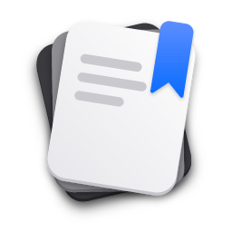
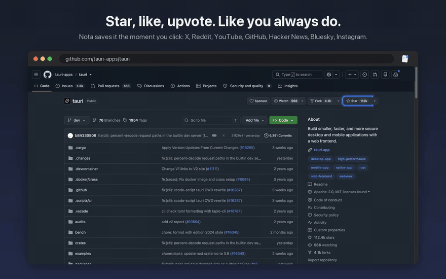
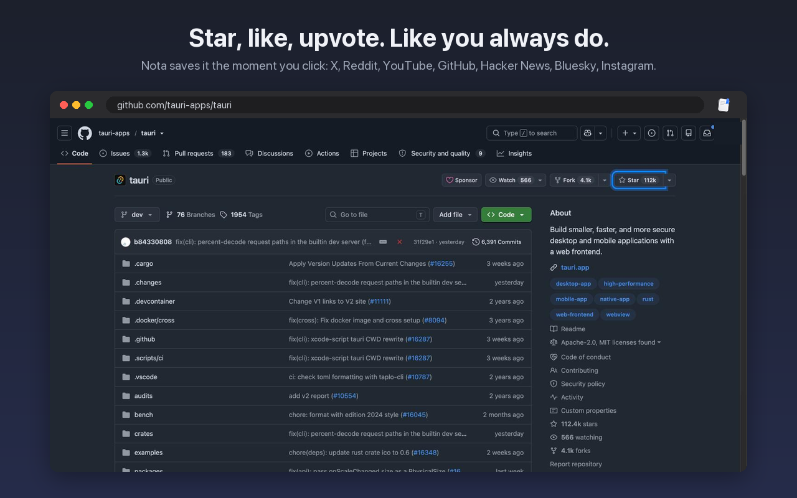
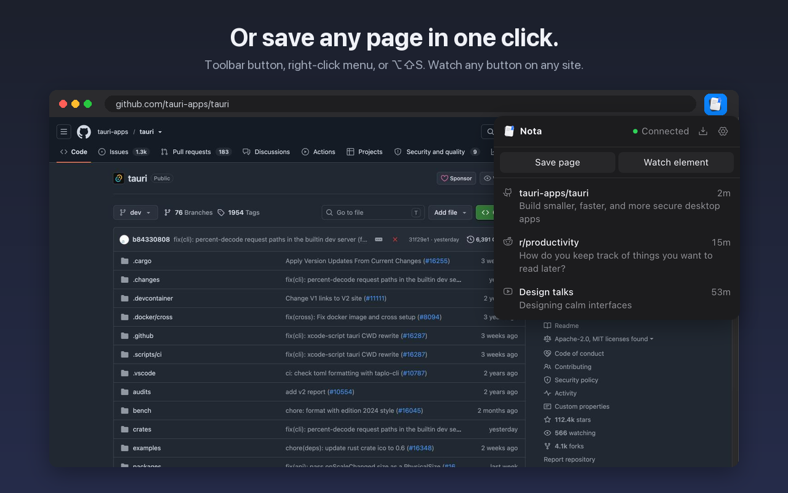
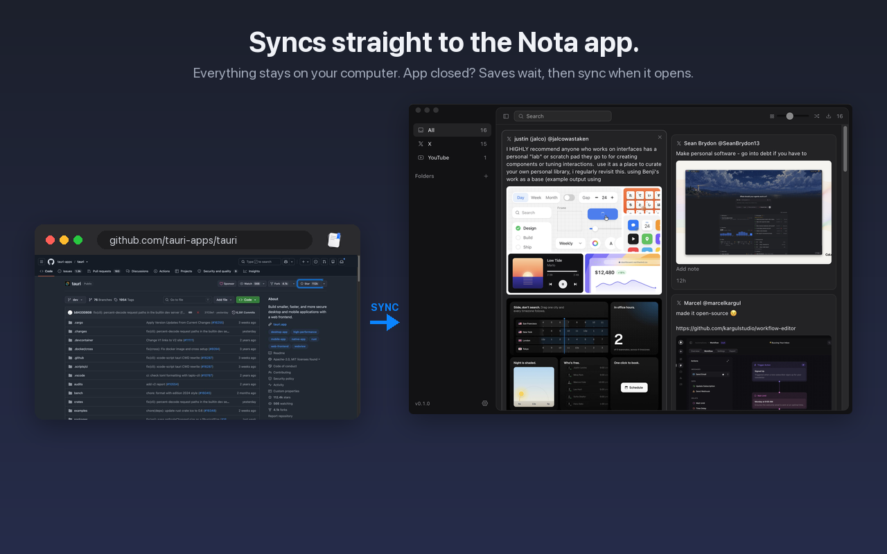
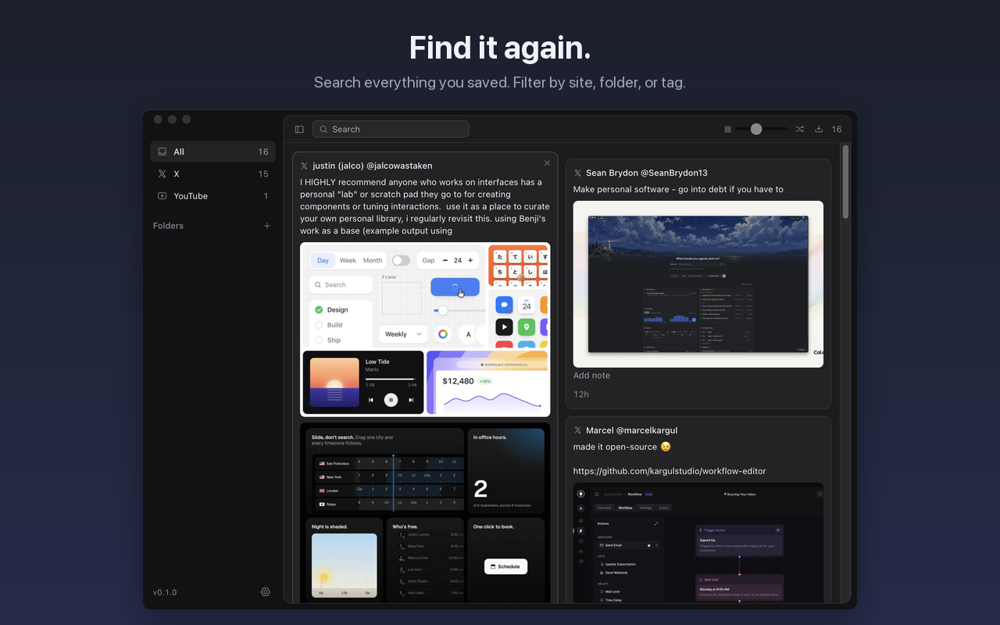

<p align="center">
  
</p>

<h1 align="center">Nota</h1>

<p align="center">
  Unify all your likes, locally.<br>
  <a href="https://github.com/Nirzhuk/nota/releases/latest">Download the app</a>
</p>

<p align="center">
  
</p>

You like a tweet, star a repo, upvote a thread, add a video to Watch later.
A week later you want it back and can't remember where it was. Nota keeps all
of it in one app on your computer that you can search.

You don't change how you browse. Click like the way you always do and the
Nota extension sends that post to the Nota app. Nothing goes to a server.

[Watch the 13 second demo (mp4)](docs/demo.mp4)

## How it works

**1. Like things where you already are.** Nota saves the post the moment you click.



| Site | Nota saves when you |
|---|---|
| X | like, bookmark |
| Reddit | upvote |
| YouTube | like, add to Watch later or any playlist |
| GitHub | star |
| Hacker News | upvote, favorite a story |
| Bluesky | like, bookmark |
| Instagram | save |

**2. Or save any page by hand.** Use the toolbar button, the right-click menu,
or <kbd>⌥</kbd><kbd>⇧</kbd><kbd>S</kbd> (<kbd>Alt</kbd><kbd>Shift</kbd><kbd>S</kbd> on Windows).



**3. It goes straight to the app.** If the app is closed, the extension holds
on to your saves and sends them the next time Nota opens. The toolbar badge
shows how many are waiting.



**4. Find it again.** Search everything, filter by site, sort things into
folders and tags.



## Save anything

Right-click a page, link, image or selected text and pick **Save … to Nota**.
<kbd>⌥</kbd><kbd>⇧</kbd><kbd>S</kbd> saves the current page. Nota reads the
page's own preview info (the `og:` title, description and image), so any site
works without setup.

## Watch any button

Want Nota to save when you click something it doesn't know about? Teach it.

1. Open the popup on that site and click **Watch element**.
2. Click the button you care about, like a YouTube like or a "Read later" link.
3. Give it a name, like `read later`. That name becomes the tag.

From then on, clicking that button saves the page with that tag. Chrome asks
for permission once per site. The popup's **Watching** list shows when each
one last fired. If one says **never fired**, the site probably renamed its
button.

Watched buttons always save, even if you turned off automatic saving for that
site (gear icon, then **What Nota saves**).

## Bring in what you already have

Importing again is safe: posts you already have merge into one card, and posts
you removed stay removed unless you save them again yourself.

**Reddit.** Sign in to reddit.com, open the popup, click **Import**. You get
your upvoted and saved posts with images and links. Reddit only returns the
last 1000 of each. Tags are `#reddit-upvoted` and `#reddit-saved`.

**X.** Open your bookmarks (`x.com/i/bookmarks`), your Likes tab
(`x.com/i/history/likes`), or `x.com/i/history`, then click **Import** in the
popup. On the History page an **Import all** button appears in the corner: it
walks the Bookmarks and Likes tabs, scrolls each list, and counts the posts it
saves. Press Esc or click the button again to stop. Tags are `#x-bookmarks` and
`#x-likes`.

**X archive.** This gets every like you ever made. Download your data from X,
click the download icon in the Nota app, and pick `data/like.js`. The archive
has text and links only, no images or bookmarks. Tag is `#x-archive`. If you
also saved the same post live, Nota merges the two.

## Using the app

- Drag a card by its top row onto a folder. Double-click a folder to rename it,
  right-click to rename or delete.
- Click the circle beside a card's × to mark it read: the card shrinks and greys
  out. The filter in the header shows all saves, unread, read, media, links, or
  saves with your own note.
- <kbd>/</kbd> or <kbd>⌘</kbd><kbd>F</kbd> searches. Every word has to match,
  and tags count.
- <kbd>⌘</kbd><kbd>2</kbd> to <kbd>⌘</kbd><kbd>9</kbd> filter by site,
  <kbd>⌘</kbd><kbd>=</kbd> and <kbd>⌘</kbd><kbd>−</kbd> resize cards,
  <kbd>⌃</kbd><kbd>⌘</kbd><kbd>S</kbd> hides the sidebar.
- On Windows, use <kbd>Ctrl</kbd> for <kbd>⌘</kbd>, and
  <kbd>Ctrl</kbd><kbd>Shift</kbd><kbd>S</kbd> hides the sidebar. Settings lists
  every shortcut for your system.
- When a new version is out, an **Update** button appears at the bottom of the
  sidebar.

Your notes are one JSON file:
`~/Library/Application Support/app.nota.desktop/notes.json` on macOS,
`%APPDATA%\app.nota.desktop\notes.json` on Windows.

Images from new saves are also copied to an `images` folder next to it, so they
survive if the post is deleted. Turn this off or clear the copies in Settings.

## Ask your AI assistant

Connect Hermes, Claude Code or Claude Desktop in Settings, under **AI assistants**,
then ask it things like "what did I save about Rust?". Other assistants that
support MCP can use the setup shown under **Other assistant**.

You can also ask it to organize them, like "tag my untagged saves". Assistants
can search and read your saves, add tags and move saves to folders, but can't
remove tags, edit or delete saves. Searching works with Nota closed; organizing
needs it open. Nota only talks to them on your computer, but what an assistant
reads goes to its AI provider. Saved posts are written by other people, so an
assistant could be misled by text inside one, and mislabel your saves.

## Development

```
apps/extension   Chrome extension (MV3), no build step
apps/desktop     Tauri app, listens on 127.0.0.1:4317
```

1. `bun install`
2. `bun dev` starts the desktop app.
3. In Chrome, open `chrome://extensions`, turn on Developer mode, click
   **Load unpacked** and pick `apps/extension`.
4. Like a tweet. It shows up in Nota.

## Releasing

**Desktop app.** Bump `version` in `apps/desktop/src-tauri/tauri.conf.json` and
push to `main`. CI builds a universal macOS `.dmg` and a Windows `.exe`
installer, publishes them as release `v<version>`, and installed copies offer
the update. A push without a version
bump doesn't release anything. To build a signed copy locally, run
`bun run release` in `apps/desktop`.

This needs the repo secrets `TAURI_SIGNING_PRIVATE_KEY` and
`TAURI_SIGNING_PRIVATE_KEY_PASSWORD` (from `~/.tauri/nota-updater.*`), plus the
`APPLE_*` secrets for signing and notarizing, listed in
`.github/workflows/release.yml`.

**Extension.** Bump `version` in `apps/extension/manifest.json`, zip
`apps/extension`, and upload it in the Chrome Web Store developer dashboard.

## Contributing

Bug reports and PRs are welcome. When a site changes its buttons and saves
stop working, a selector fix in `apps/extension/content-<site>.js` is the most
useful PR you can send. See [CONTRIBUTING.md](CONTRIBUTING.md).

## License

[MIT](LICENSE)
